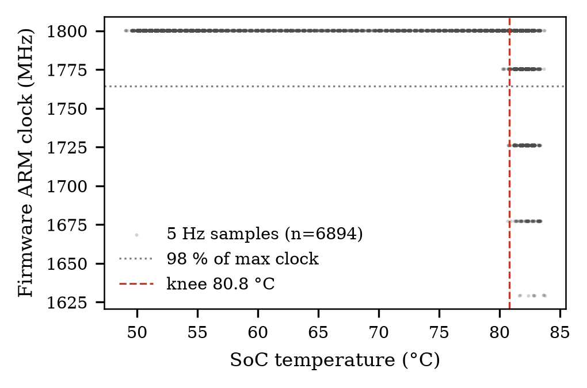
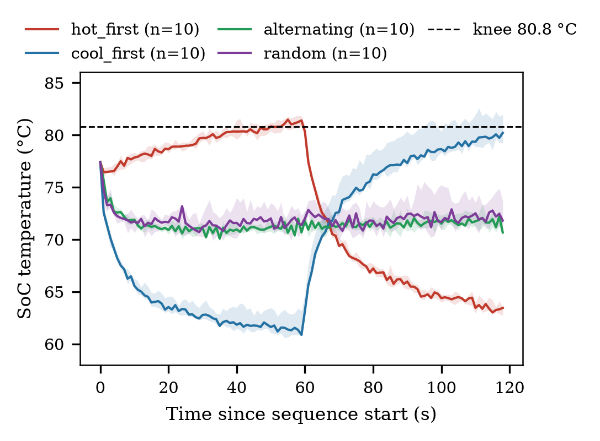
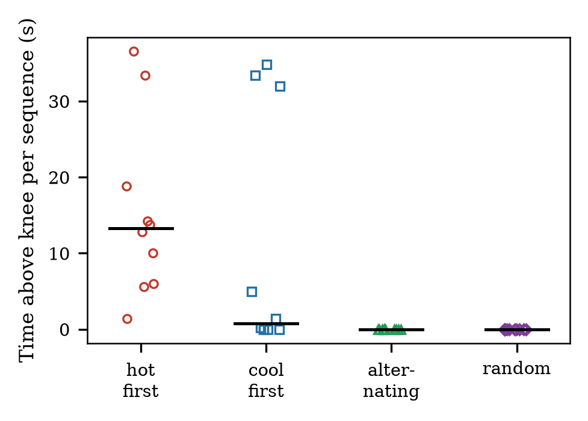
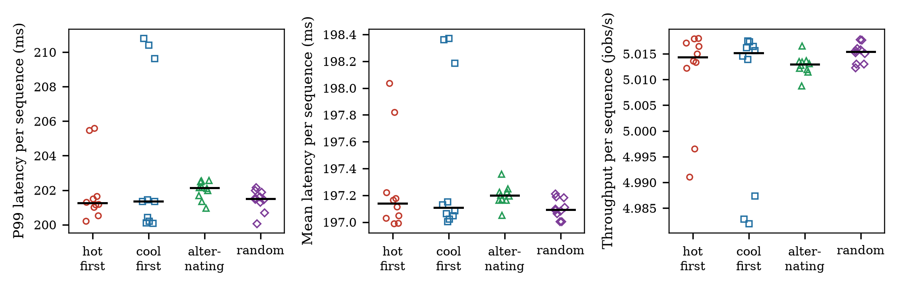
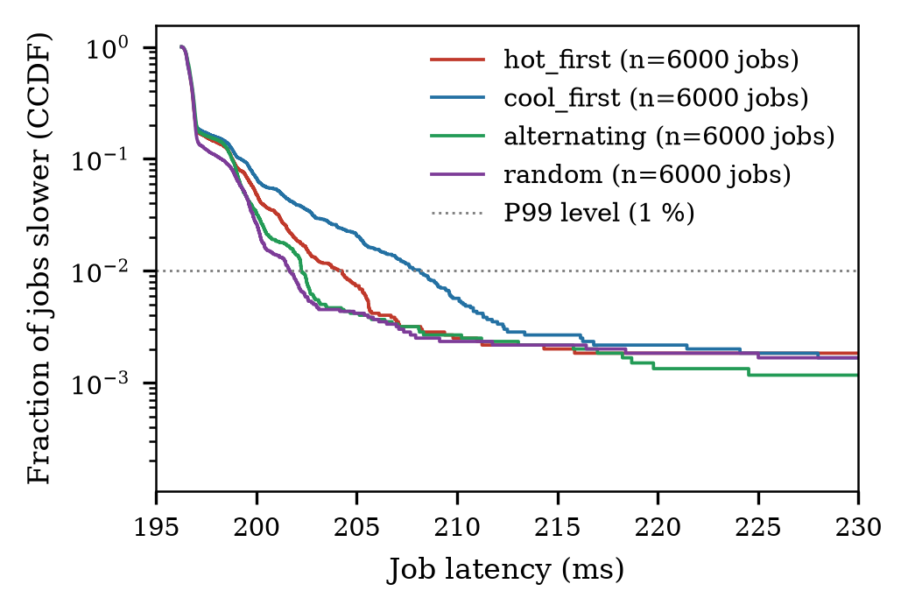

# Abstract

On passively cooled edge devices, the firmware throttles the CPU clock once the die is hot. One idea is to order
work so that heat-producing jobs are interleaved with lighter ones and fewer jobs run while throttled. We tested
whether ordering alone changes tail latency.

**Setup.**
- **Device:** a Raspberry Pi 4 Model B (Rev 1.4, Debian 13).
- **Jobs:** a matched pair of fixed-work four-core jobs, "HOT" (CPU duty 0.99) and "COOL" (duty 0.38), whose
  cold latencies differ by −0.05 % (95 % CI [−0.08 %, −0.001 %]).
- **Orderings:** four orderings of an identical 600-job multiset (300 HOT, 300 COOL): hot-first, cool-first,
  alternating and random.
- **Repetitions:** 10 interleaved, counterbalanced repetitions each (40 sequences, 24,000 jobs).
- **Start state:** each sequence started at 77.4–77.9 °C after a standardised cooldown and pre-heat.
- **Preregistration:** the hypotheses, gates and analysis were fixed before the data.

**Preregistered gates.**
- **Throttle knee (G1):** found at 80.8 °C in the firmware ARM clock.
- **Service time vs temperature (G2):** rises with temperature (+0.208 ms/°C, 95 % CI [+0.070, +0.343]).
  It is flat at about 196.4 ms below the knee and 208–212 ms on the throttling plateau.
- **Cold-latency match (G3):** holds.
- **Ordering moves the thermal trajectory (G4):** hot-first spent a median 13.3 s above the knee per sequence;
  alternating and random spent 0 s (difference 13.3 s, 95 % CI [6.0, 23.8]).
- **Ordering moves tail latency (G5):** no. Median per-sequence P99 ranged from 201.3 to 202.1 ms across
  orderings, and no pairwise difference survived Holm correction.
- **Mean latency and throughput (G5b):** no supported difference either.
- **Verdict:** the preregistered verdict is LIKELY KILL. Ordering changes the thermal trajectory, but at this
  operating point it did not produce a statistically supported change in tail latency, mean latency or
  throughput.

**Why the tail did not move (exploratory analyses).**
- Throttling at this horizon is shallow: HOT jobs that started at or above the knee had a median latency only
  0.7 % higher.
- Only about 2–3 of 600 jobs per sequence exceeded 205 ms, so P99 is set by ordinary jobs.
- The device's thermal state shifted during the three-hour session. In the first hour, blocked orderings
  produced P99 values of 205–211 ms.

We report the negative result, its limits (one device, one workload, one starting band) and the hypotheses it
leaves open.

**Index terms:** thermal throttling, task ordering, tail latency, edge computing, Raspberry Pi, negative result,
preregistration.

# I. Purpose and Objectives

## A. Motivation

**Thermal limits matter at the edge.** Edge devices increasingly run sustained compute workloads without
active cooling. When their system-on-chip (SoC) heats up, firmware lowers the CPU clock to stay within a
thermal limit. On the Raspberry Pi 4, the vendor documents progressive throttling of the Arm cores between
80 °C and 85 °C [8]. Thermal throttling has long been studied as dynamic thermal management (DTM) in processor
design [1], [2], and operating-system schedulers have been shown to reduce thermal emergencies by choosing what
runs when [3], [4], [6]. Order matters physically: for a fixed set of tasks, the temperature reached depends on
the order in which they run [5].

**A thermal effect is not a performance effect.** Changing a device's thermal trajectory does not by itself
change what an application observes. A throttled job is slower only by the clock reduction it actually
experiences. A tail percentile moves only if enough jobs are slowed by enough. A reordering that keeps the die
below its knee for longer is therefore a *candidate* mechanism for lower tail latency, not evidence of it.

## B. Research question and objectives

For an identical multiset of fixed-work jobs with matched cold latency, does the order
in which the jobs run change (a) the time the device spends above its throttling knee and (b) the tail
latency, mean latency and throughput of the jobs?

We answered this with a preregistered, gate-based pilot ("TDAS") on a Raspberry Pi 4. The pilot was designed
to falsify the idea cheaply. Each gate's test and the overall verdict were fixed before the data that decided
them, and every change of design was recorded as a dated amendment before the data it governed.

**Contributions,** limited to what the evidence shows:

1. **A measured throttling knee and service-time curve** for this device and workload, under supervision
   (Section III-A, III-B).
   - The knee is at 80.8 °C in the firmware ARM clock.
   - The Linux `scaling_cur_freq` interface did not show this throttling at all.
   - Service time is flat below the knee and steps up by about 6–8 % on the throttling plateau.
2. **A preregistered ordering experiment with a negative primary outcome** (Section III-C to III-F).
   - Ordering changed the time spent above the knee.
   - It did not produce a statistically supported change in P99, P95, mean latency or throughput at the tested
     operating point.
   - The preregistered verdict is LIKELY KILL.
3. **An analysis of why the thermal effect did not reach the measured tail** (Section III-I to III-L), separated from the
   confirmatory results and labelled exploratory:
   - shallow throttling at a two-minute horizon;
   - the order statistic that a 600-job P99 actually measures;
   - a within-session shift in the device's thermal state.
4. **Disclosure of the measurement pitfalls met on the way** (Section II-H):
   - an instrument blind spot;
   - a supervision process that perturbed job latency;
   - a design flaw in an early validity rule.

We do not propose a new scheduling algorithm, and we do not claim that ordering never matters. The study tested
one operating point and found no supported performance effect there.

**Organisation.** Section I-C reviews related work. Section II describes the system, the workload, the
preregistered gates and the statistics. Section III reports G1–G6 in their preregistered order, then
interprets them and states the limitations. Section IV concludes.

## C. Background and related work

**Dynamic thermal management.**
- Brooks and Martonosi [1] studied DTM mechanisms that respond when a processor approaches its thermal limit.
  They argued that designing for typical rather than worst-case power is possible with little performance
  loss on typical applications.
- Skadron et al. [2] introduced the HotSpot model and runtime temperature-management techniques, including
  frequency scaling and migrating computation. They noted that activity metrics are poor proxies for
  temperature, and that sensor inaccuracy affects the performance of DTM.

Our device uses firmware-controlled frequency reduction of this kind. The application has no DVFS authority,
which makes ordering one of the few levers left to software.

**Thermal-aware task scheduling.**
- **Choi et al.** [3] used operating-system scheduling to exploit temporal and spatial "heat slack", shifting
  work to let on-chip units cool.
- **Yang et al.** [4] built a thermal-aware OS job scheduler in the Linux kernel. It exploits differences in
  thermal behaviour among jobs to keep temperature under a budget. They reported 10.5–73.6 % fewer hardware DTM
  events and up to 7.6 % (4.1 % on average) higher throughput.
- **Chrobak et al.** [5] formalised temperature-aware scheduling of unit jobs with heat contributions, noting
  that the temperature depends on the execution order. They gave complexity results and an online algorithm.
- **Coskun et al.** [6] reduced hot spots, spatial gradients and thermal cycles on multiprocessor SoCs with
  static and dynamic scheduling, at negligible performance overhead.
- **Mobile devices:** Sahin and Coskun [7] showed that throttling degrades user-visible quality of service.
  Their runtime techniques sustained acceptable performance for up to 8× longer.

These works establish that scheduling changes thermal behaviour, and, on their platforms and objectives, can
change throughput or QoS. Our study differs in four ways:
- **The control.** It holds the *work* fixed: the same jobs with matched cold latency, differing only in
  order.
- **The outcome.** It measures *tail latency* as the primary outcome.
- **The platform.** It runs on a low-cost single-board computer with firmware-only DVFS.
- **The design.** It is preregistered with explicit kill criteria.

**Tail latency and its measurement.**
- **Why tails matter:** Dean and Barroso [10] explained why tail latency, not the mean, dominates user
  experience in large services.
- **Measurement methodology:** Zhang et al. [11] showed that tail-latency measurements are sensitive to
  load-testing methodology. Their quantile-regression attribution reduced P99 latency by 43 % in a production
  setting.
- **Percentile definitions:** sample percentiles have several definitions [12]. With 600 observations, a P99
  rests on a handful of order statistics, which matters for our interpretation (Section III-J).
- **Statistical tools used here:** bootstrap confidence intervals [13], Holm's sequentially rejective
  correction [14] and Cliff's dominance statistic [15].

**Measurement rigour and preregistration.**
- Hoefler and Belli [16] gave guidelines for reporting performance results, including summarising with
  appropriate statistics and confidence intervals.
- Mytkowicz et al. [17] showed that innocuous-looking setup changes can bias performance measurements.
- Nosek et al. [18] argued for preregistration, which separates confirmatory from exploratory analysis.

We follow that separation throughout.

**Raspberry Pi thermal behaviour.**
- **Official documentation** describes the 80–85 °C throttling range [8] and the `get_throttled` status bits
  [9] that we use to detect under-voltage and throttling.
- **Other reports:** many reports characterise Pi 4 cooling informally, in vendor and hobbyist benchmarks. We
  did not find a peer-reviewed study of job ordering against tail latency on this platform. Our search was
  limited, so this is not a claim that none exists.

# II. Methodology and Approach

## A. Hardware and software

**Hardware and operating system.**
- **Device:** Raspberry Pi 4 Model B Rev 1.4 (BCM2711, four Arm cores, maximum `arm_freq` 1800 MHz, 1.8 GiB
  usable memory).
- **Operating system:** Debian GNU/Linux 13, kernel 6.18.50+rpt-rpi-v8, firmware a8698392 (14 Sep 2026).
- **Governor:** `performance` on all four cores.
- **Temperature limits:** no `temp_limit` or `temp_soft_limit` override was configured.

**Software.** Python 3.13.5 and NumPy 2.2.4, linked against the single-threaded Debian reference BLAS.

**Cooling.** A bare board with no heatsink or fan, in open air, as the protocol specifies. No cooling device
is registered with the kernel. The experimenter confirmed this configuration after the study; it was not
logged separately on the day of Experiment 3. Ambient temperature was not measured (Section III-M).

## B. Workload: matched fixed-work jobs

A job uses all four cores at once. One worker process is pinned to each core and runs a fixed number of timed
units. A unit is 4 consecutive 128×128 single-precision matrix multiplications. Job latency is measured from
the dispatch of the first shard to the reply of the last.

The two job classes (frozen parameter set `P4c-F1`) are:
- **HOT:** 13 units per core and no sleep. Measured CPU duty is 0.994.
- **COOL:** 5 units per core with 119.55 ms of sleep spread between them. Measured CPU duty is 0.385.

A preregistered workload validation (40 accepted HOT/COOL pairs) accepted this pair. Its acceptance criteria
were:
- **Cold-latency match:** median HOT latency 196.32 ms, COOL 196.22 ms; relative gap −0.050 %, 95 % CI
  [−0.080 %, −0.001 %], within the preregistered ±2 % target.
- **Unit-time CV:** 0.83 %.
- **HOT-latency CV:** 0.35 %.

The two classes therefore take the same time when cold but differ in heat produced. An identical multiset of
them can differ only in order. That is our definition of the experimental manipulation (Amendment A2): the
same number of each class, the same planned units and the same planned sleep. Energy was not measured.

## C. Orderings and sequences

Every sequence contains 600 jobs, 300 HOT and 300 COOL. They are run back to back, which takes 119.6–120.4 s.
The four orderings use the protocol's names:
- `hot_first`: 300 HOT jobs, then 300 COOL jobs;
- `cool_first`: the reverse;
- `alternating`: HOT and COOL in turn;
- `random`: a new permutation for each sequence, from a seeded generator.

**Repetitions and schedule.** Each ordering was repeated 10 times. The 40 sequences were interleaved and
counterbalanced: each repetition block contains all four orderings, alternate blocks are reversed and then
shuffled, with seed 0.

**Starting state of each sequence:**
1. **Cooldown:** with no load, to idle + 3 °C (48.3 °C; the idle baseline of 45.28 °C was measured at the
   start of the session). Capped at 20 min.
2. **Pre-heat:** back-to-back HOT jobs, not recorded as part of the sequence, until the temperature read
   before a job was at least 77.0 °C. Capped at 5 min.
3. **Sequence:** starts immediately.

Sequences therefore started at 77.4–77.9 °C, just below the knee. The pre-heat took 31–53 s.

## D. Measurement

**Temperature.** The SoC temperature was read from Linux sysfs (`thermal_zone0`) by a 5 Hz logger thread
during each sequence (23,843 samples in total). Readings are quantised in steps of 0.487 °C.

**Per job.** The recorded fields are:
- the temperature read just before dispatch;
- latency, CPU time and completed units;
- the firmware throttle flags (`vcgencmd get_throttled` [9]), read between jobs and outside the timed
  interval.

**What was not read live.** The firmware ARM clock was not read during Experiment 3. Live clock reads were
reserved for Experiment 2, because a stall control showed that they perturb a small fraction of jobs.

**Supervision.**
- An external watchdog stops the run with a single SIGTERM if the temperature reaches 85.0 °C, under-voltage
  is reported, or readings fail. It is written so that its loop starts no processes (Section II-H).
- The experiment process refuses to start load until it has verified that watchdog.
- The workers are never killed with SIGKILL.

## E. Thermal knee (G1)

The knee comes from a separate supervised Experiment 1 run:
- **Load:** four HOT workers, continuous, for 15 min, with all cores at 99.9–100 % busy.
- **Clock:** the firmware ARM clock was read through `vcgencmd measure_clock arm`.
- **Definition (preregistered):** the knee is the lowest temperature at which the clock read below 98 % of the
  run's maximum.

Amendment A3 moved the knee measurement from Linux `scaling_cur_freq` to the firmware clock, before the run.
An instrument check had shown that `scaling_cur_freq` does not reflect firmware throttling on this device
(Section III-A).

## F. Preregistered gates and verdict

The gates were defined in the protocol and in Amendments A1–A7, each approved before the data it governs:

| Gate | Question | Test | Source |
|---|---|---|---|
| G1 | Is there a throttle knee? | knee measured in a valid Exp. 1 run (A1, A3) | Exp. 1 |
| G2 | Does service time depend on temperature? | OLS slope of bin-median latency on bin-median temperature; 2 °C bins per ramp with ≥ 20 jobs; cluster bootstrap over (ramp, bin), 2000 resamples; PASS if the 95 % CI is above 0 (A4) | Exp. 2 |
| G3 | Are HOT and COOL indistinguishable when cold? | cold-latency gap within target in the accepted workload validation | validation |
| G4 | Does ordering change time above the knee? | largest minus smallest per-ordering median time above the knee; percentile bootstrap (10,000 resamples, seed 0); PASS if the 95 % CI excludes 0 | Exp. 3 |
| G5 | Does ordering change tail latency? | 6 pairwise differences of per-ordering median per-sequence P99; bootstrap p-values, Holm-corrected at α = 0.05 (A7); PASS if any pair survives | Exp. 3 |
| G5b | Do secondary metrics respond? | the same for mean latency and throughput, Holm within each metric | Exp. 3 |
| G6 | Is the effect mediated? | corr(time above knee, P99) > 0.3, tested only if G4 and G5 pass | Exp. 3 |

**Validity (A7).** G3–G6 are decided only by a completed, supervised session with P4c jobs, a G1 knee and at
least 8 valid sequences per ordering. Otherwise they are INCONCLUSIVE.

**Verdict rule** (`analyze.overall_verdict`, fixed before Experiment 3):
- a failure of a structural gate (G1, G2 or G4) is KILL;
- G5 failing with a secondary metric responding is REFORMULATE;
- **G5 failing with no secondary response is LIKELY KILL;**
- G1, G2, G4 and G5 all passing is PROCEED.

## G. Statistical methods and unit of analysis

**Unit of analysis.** The unit is the sequence: n = 10 per ordering. Per-sequence P99 and P95 use NumPy's
default linear-interpolation percentile (Hyndman–Fan type 7 [12]). For 600 jobs, P99 is the 7th-largest
latency, interpolated 1 % of the way toward the 6th largest.

**Differences.** Differences are differences of medians across sequences. They are estimated with an
unpaired percentile bootstrap [13]. The two-sided p-value is min(1, 2·min(P(Δ* ≤ 0), P(Δ* ≥ 0))) over the
10,000 bootstrap differences Δ*. Effect sizes are reported as median differences in ms and as Cliff's δ [15].

**Independence.** The bootstrap treats the sequences of an ordering as exchangeable. They were in fact run
serially on one device. The interleaved, counterbalanced schedule protects the comparison between orderings
from linear drift, but not from all time dependence (Section III-M).

**Exploratory analyses.** Everything outside the preregistered gates is labelled exploratory and cannot change
the verdict.

## H. Integrity checks and disclosed deviations

**Integrity.**
- Every run archive is stored with its SHA-256 hash, which matches the copy on the device.
- The code installed on the device was hash-pinned by the launcher.
- Every per-sequence metric in the official record was recomputed from the raw job and telemetry records for
  this paper, by independently written code, and matched to within 10⁻⁶. The gate statistics and the verdict
  reproduce exactly (Section III, evidence audit).

**Disclosed deviations and pitfalls:**
1. **Instrument blind spot.** Linux `scaling_cur_freq` read 1800 MHz in all 6,894 samples of the Experiment 1
   run, while the firmware ARM clock fell to 1629 MHz (A3).
2. **Supervision perturbing the measurement.** An earlier four-core workload candidate ("P4b") was rejected on
   latency variability. Diagnostics traced the variability to the external watchdog's process starts, every
   5 s, while all four cores were busy: 8 of 8 stalls fell on poll-overlapped jobs. The watchdog was rewritten
   to start no processes, and the accepted configuration (P4c) was validated under it.
3. **Validity-rule flaw.** The first Experiment 2 run was INCONCLUSIVE because A4's coverage rule could not be
   met at four-core heating rates. The fix was a paced warm-up (A5). Amendment A5 was approved by the
   experimenter's assistant under delegation and accepted by the experimenter afterwards.
4. **Safety stop.** The second Experiment 2 run was safety-stopped at 85.2 °C. Amendment A6 shortened each ramp
   to 240 s after the warm-up.

Both earlier Experiment 2 runs remain on record as INCONCLUSIVE. G2 is decided by the third run.

# III. Results and Findings

## A. G1 — throttle knee

In the Experiment 1 run (6,894 samples at 5 Hz, no clock reading missing):
- **Clock:** the firmware ARM clock fell from 1800.5 MHz to a minimum of 1629.4 MHz, a depth of 9.5 %.
- **Knee:** 477 samples were below 98 % of the maximum. The lowest temperature among them, the knee, was
  **80.83 °C** (Fig. 1). This agrees with the vendor's 80–85 °C throttling range [8].
- **Linux interface:** `scaling_cur_freq` never left 1800 MHz.
- **Gate:** G1 **PASS**.
- **Cooling:** the cooling time constant fitted in this run was 106.7 s.

## B. G2 — service time against temperature

In Experiment 2, run 3 (2 ramps, 3,027 HOT jobs, 36 kept bins), the OLS slope of bin-median latency on
bin-median temperature is **+0.208 ms/°C** (95 % cluster-bootstrap CI [+0.070, +0.343]). G2 is **PASS**.

The relationship is not linear (Fig. 2):
- **Below the knee:** bin-median latency stays within 196.23–196.55 ms in all 30 bins, from 47.7 °C to 79.4 °C.
- **Just above the knee:** 197.4–198.0 ms at 81.3–81.8 °C.
- **On the plateau:** 207.9–208.5 ms at 83.3 °C and 211.0–212.1 ms at 84.2 °C.

The slope is the preregistered summary of what is really a step at the knee.

## C. G3 — cold-latency match

From the accepted workload validation (40 pairs):
- **Medians:** HOT 196.32 ms, COOL 196.22 ms.
- **Gap:** −0.050 %, 95 % CI [−0.080 %, −0.001 %], class TARGET MET.

G3 is **PASS**: job-length differences cannot explain ordering effects, within this tolerance.

## D. Session validity

The Experiment 3 session ran 40 of 40 scheduled sequences in about 3 h. All 40 were valid (10 per ordering)
and none needed a rerun.
- No under-voltage was flagged.
- No watchdog signal was sent.
- Cleanup was verified.
- Every sequence contained exactly 300 HOT and 300 COOL jobs in its ordering's structure.
- All 24,000 jobs completed their planned units.

The A7 validity rule is met.

## E. G4 — ordering and time above the knee

Ordering changed the thermal trajectory (Fig. 3, Fig. 4; Table I):
- **hot_first** ran up toward the knee during its HOT half.
- **cool_first** first cooled to about 61 °C, then climbed toward the knee.
- **alternating** and **random** settled near 71–72 °C and stayed below the knee.

Median time above the knee per sequence was 13.3 s (hot_first), 0.8 s (cool_first) and 0 s (alternating and
random). The preregistered contrast, between the largest and smallest median (hot_first − alternating; random
is tied at 0), is **+13.3 s, 95 % CI [+6.0, +23.8]**. G4 is **PASS**.

**Table I. Per-ordering summary, median [interquartile range] over 10 valid sequences each.**

| | hot_first | cool_first | alternating | random |
|---|---|---|---|---|
| Time above knee (s) | 13.3 [7.0, 17.7] | 0.8 [0.0, 25.3] | 0.0 [0.0, 0.0] | 0.0 [0.0, 0.0] |
| Peak temperature (°C) | 82.3 | 81.1 | 77.4 | 77.4 |
| P99 latency (ms) | 201.26 [201.05, 201.61] | 201.35 [200.27, 207.60] | 202.14 [201.76, 202.42] | 201.51 [201.34, 201.83] |
| P95 latency (ms) | 199.39 | 199.44 | 199.40 | 199.34 |
| Mean latency (ms) | 197.14 | 197.11 | 197.20 | 197.09 |
| Throughput (jobs/s) | 5.014 | 5.015 | 5.013 | 5.015 |

## F. G5 and G5b — tail latency, mean latency, throughput

Median per-sequence P99 differed by at most 0.88 ms (0.44 %) between any two orderings (Fig. 5, Table II).
- **Uncorrected:** one pair's CI excluded zero (alternating − random, +0.62 ms, p = 0.046).
- **Holm:** with six pairs, Holm's first step requires p ≤ 0.0083, so no pair survives. G5 is **FAIL**.
- **Secondary metrics:** for mean latency and throughput, the smallest p-values (0.037 and 0.045, the same pair)
  also fail Holm's first step. G5b is **FAIL**.

**Table II. Pairwise differences in median per-sequence P99 (ms), bootstrap 95 % CI, two-sided bootstrap p, Holm decision, Cliff's δ.**

| Pair | Δ median P99 | 95 % CI | p | Holm | δ |
|---|---|---|---|---|---|
| alternating − cool_first | +0.79 | [−7.66, +1.97] | 0.306 | no | +0.30 |
| alternating − hot_first | +0.88 | [−1.29, +1.36] | 0.068 | no | +0.44 |
| alternating − random | +0.62 | [+0.01, +1.08] | 0.046 | no | +0.56 |
| cool_first − hot_first | +0.09 | [−1.97, +8.45] | 0.979 | no | +0.00 |
| cool_first − random | −0.16 | [−1.39, +8.18] | 0.389 | no | −0.12 |
| hot_first − random | −0.26 | [−0.75, +1.90] | 0.340 | no | −0.14 |

## G. G6 — mediation

G6 is defined only when both G4 and G5 pass. Because G5 failed, G6 is **not testable**.

## H. Verdict

The committed analysis code, applied to the Experiment 1, 2 and 3 records, returns G1–G4 PASS, G5 and G5b
FAIL, G6 not tested, and the preregistered verdict **LIKELY KILL**: the thermal trajectory moves, but no
performance metric responds. We reproduced this verdict from the raw records with independently written code.

## I. A thermal effect without a performance effect

The confirmatory result separates two things that are easy to conflate. Ordering changed *when* and *for how
long* the die was above its knee (G4). It did not change the latency distribution enough to register in P99,
mean latency or throughput (G5, G5b). The exploratory analyses below suggest why. They are post hoc and
cannot change the verdict.

**At a two-minute horizon starting just below the knee, throttling is shallow.**
- **Few jobs exposed.** Pooled over all orderings, 1,258 of 12,000 HOT jobs started at or above the knee.
  Their median latency was 198.29 ms, against 196.87 ms for HOT jobs that started below it: +0.7 %. Their 90th
  percentile was 204.99 ms against 198.98 ms.
- **Mild throttling.** The clock reductions that Experiment 2 associated with 208–212 ms latencies appear only
  after minutes of continuous load. In Experiment 3, a hot_first sequence spends at most 60 s on HOT work.

**Exposure is concentrated in a few jobs.** hot_first sequences had a median of 60 jobs per sequence that
started at or above the knee (10 % of jobs). Most of those jobs were only slightly slower.

## J. What P99 measures for 600 jobs

Per sequence, P99 is in effect the 7th-largest of 600 latencies.
- **Slow jobs are scarce.** The median number of jobs slower than 205 ms per sequence was 2.5, 2.5, 2.0 and 2.5
  for the four orderings. The number slower than 200 ms was 14.5–18.
- **P99 sits on ordinary jobs.** The 7th-largest latency is therefore usually an ordinary job of about
  200–202 ms, not a throttled one, in every ordering.
- **Rare extremes are not thermal.** The few extreme outliers (11–15 jobs per ordering above 215 ms in 6,000)
  mostly started below the knee (Section III-L).
- **Estimate uncertainty.** A job-level bootstrap within a sequence, which assumes exchangeable jobs, gives a
  median 95 % interval width of 3.3 ms for a single sequence's P99. The test therefore compares medians of
  noisy order statistics.

**How large an effect could the test have detected?** A rough normal approximation on the per-sequence P99
spread suggests effects of about 0.9 ms (alternating vs random) to 5.6 ms (pairs involving cool_first). These
are detectable with 80 % power at Holm's first step, from 10 sequences per ordering. The observed median
differences, ≤ 0.9 ms, are below most of these thresholds.

The test was therefore not powered to detect sub-millisecond P99 effects. A non-significant result here is not
evidence of equivalence. What the data do support is narrower: at this operating point, any ordering effect on
the median per-sequence P99 is small relative to a 196 ms job. The observed differences were under 0.5 %.

## K. The starting state and the session

The preregistered design fixed a near-knee start (77 °C) and a two-minute sequence. Two exploratory
observations show how much the outcome depends on the thermal state (Fig. 7).

**The device's thermal state changed during the session.**
- **Repetitions 0–2** (the first ~70 min):
  - the median cooldown to 48.3 °C per repetition was 152, 217 and 262 s, and the median pre-heat 32–36 s;
  - in 5 of these 6 hot_first and cool_first sequences, the die spent 32–37 s above the knee;
  - their P99 was 205.5–210.8 ms;
  - the alternating and random sequences of the same repetitions stayed at 200.1–202.6 ms.
- **Repetitions 3–9:**
  - median cooldowns were 57–75 s and median pre-heats 43–48 s;
  - time above the knee fell;
  - P99 was 200.1–202.5 ms in every ordering.

The cause is unknown. Ambient temperature and airflow were not measured. Because each repetition block contains
all four orderings, the shift adds variance rather than bias to the ordering comparison. The large CIs for pairs
involving cool_first in Table II come from it.

**This pattern suggests a hypothesis, not a result.** When the device is thermally loaded enough for the blocked
orderings to spend more than about 30 s above the knee within one sequence, ordering may move P99 by several
milliseconds (~2–5 %). Testing that requires a separately preregistered study with controlled ambient
conditions.

**Pooling hides the per-sequence picture.** Pooling all 6,000 jobs of an ordering gives P99 values of 204.1
(hot_first), 207.9 (cool_first), 202.2 (alternating) and 201.6 ms (random) (Fig. 6). The pooled figures are
dominated by the few hot early-session sequences. They are not the preregistered statistic, but they show that
the choice of summary changes the impression.

(The session's first sequence needed no cooldown. The last sequence of repetition 2 already falls in the later
regime.)

## L. Alternative explanations and what the evidence supports

**Order effects.**
- **Job-length differences:** excluded within the validated tolerance (G3).
- **Linear temporal drift:** balanced by the counterbalanced schedule.
- **Nonlinear drift (Section III-K):** not excluded, but symmetric across orderings within each repetition.

**Non-thermal latency outliers.** The extreme outliers, above 215 ms, were spread evenly across orderings (11–15
per ordering). Most started below the knee, which suggests operating-system or timing noise rather than
throttling.

**Measurement perturbation.** Between-job flag reads and a status observer ran during all orderings alike. The
observer started a few processes every 60 s, as in the accepted workload validation.

**What we can and cannot conclude.**
- **Causal claim we can make:** in this design, ordering causes differences in time above the knee. The
  randomisation of the order of conditions and the identical work support that.
- **Claim we cannot make:** that ordering has no effect on tail latency. The data are compatible with small
  effects, and with larger ones in thermal states the session did not control.
- **Physical versus practical effects.** The physical effect (G4) is real. A practically useful effect, a change
  an application would notice, was not observed.

## M. Limitations and threats to validity

**Generalisability.**
- **One device and one environment:** results may differ with another unit, a heatsink, a fan, an enclosure or
  a different ambient temperature.
- **Cooling configuration on the day:** the bare-board configuration was confirmed by the experimenter
  afterwards, not logged on the day.
- **Ambient conditions:** not measured.

**Workload specificity.** The jobs are synthetic dense matrix multiplications with matched cold latency. Real
inference workloads have memory, I/O and accelerator behaviour that these jobs lack.

**Operating point.** One sequence length (600 jobs, about 120 s) and one start band (77 °C) were tested. The
protocol's sweep of three starting temperatures was not run.

**Power and percentile estimation.**
- **Sample size:** with 10 sequences per ordering, sub-millisecond P99 effects were not detectable.
- **Percentile resolution:** P99 over 600 jobs rests on about 7 order statistics.

**Statistical assumptions.**
- **Independence:** the bootstrap treats sequences as exchangeable despite serial execution on one device and
  a mid-session shift in thermal state.
- **G4 contrast:** the G4 test compares the largest and smallest medians, a pair selected from the data, as
  preregistered.
- **Holm:** controls the family-wise error within each metric only.

**Sensors.**
- **Resolution:** the SoC sensor is quantised at 0.487 °C.
- **Sampling:** 5 Hz.
- **Proxy:** time above the knee is computed from sysfs temperature, not from the firmware clock, which was not
  read during Experiment 3.

**Interference.** Between-job flag reads use a short-lived process, and a status observer polled every 60 s.
Both were present in all orderings.

**Process.**
- **Delegated approval:** one amendment (A5) was approved by the experimenter's assistant under delegation
  before the experimenter's review.
- **Earlier inconclusive runs:** two Experiment 2 runs were inconclusive before G2 was decided. Both are
  disclosed.
- **Archive scope:** raw data for all decisive runs is archived with hashes. Four helper-script checksums in
  an earlier evidence folder no longer match because those scripts were edited later. No data file is
  affected.

# IV. Conclusion and Future Scope

**Conclusion.**
- **Established.** On a passively cooled Raspberry Pi 4 running matched fixed-work four-core jobs, the order of
  an identical job multiset changed how long the device spent above its throttling knee.
- **Not established.** At the preregistered operating point (600-job sequences starting at 77 °C), that change
  did not produce a statistically supported difference in P99 latency, mean latency or throughput.
- **Verdict:** the pilot's preregistered verdict is LIKELY KILL for the claim that ordering alone improves tail
  latency on this device.

**Future scope.** The following are *future experiments*, not findings. Each would need its own preregistered
hypothesis, protocol and success criteria, and none can revise the present verdict:
1. Longer hot blocks or horizons that reach the deep throttling plateau, within the device's safety limit.
2. Controlled initial thermal states and ambient conditions, motivated by the exploratory session shift.
3. Tail-sensitive designs: more jobs per sequence, or more sequences per ordering, sized by a power analysis
   from the variance observed here.
4. Other devices, cooling configurations and real inference workloads.

# Author Contributions

Srijan Srivastava carried out the research and prepared the paper. Padma Priya supervised the work and provided guidance.

# Acknowledgment

The authors used Claude (Anthropic), a generative AI assistant, throughout this work to help write and test the code, analyse the data, and draft the text and figures, and it approved amendment A5 under delegation; the authors reviewed the output and take full responsibility for the content.

# References

See `references.md` (IEEE style). In-text numbers [1]–[18] refer to that list.
